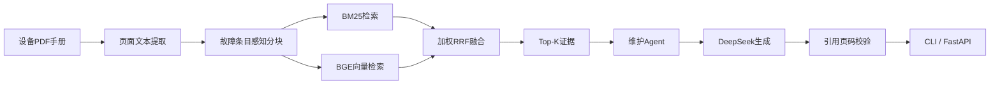

# MaintAgent

面向工业变频器维护场景的可评测 RAG Agent。

MaintAgent 从设备编程手册中检索故障证据，调用大模型生成排查建议，并校验回答中的 PDF 页码引用。当前示例知识库使用 Schneider Electric ATV340 中文编程手册构建。

> 本项目用于技术研究和辅助检索，不能替代设备制造商文档或具备资质的现场维护人员。

## 核心能力

- 使用 PyMuPDF 提取 PDF 页面文本
- 按故障代码条目进行结构感知分块
- 使用 BM25 与 BGE 中文向量模型执行混合检索
- 使用加权 RRF 融合关键词与语义检索结果
- 使用 DeepSeek API 生成受手册证据约束的回答
- 自动校验回答引用的 PDF 页码是否来自检索证据
- 引用不合法时阻止答案输出
- 提供命令行问答和 FastAPI HTTP 接口
- 提供开发集、独立测试集和自动化测试

## 系统流程



## 检索方案

### 关键词检索

使用 `jieba` 分词和 `rank-bm25` 建立中文 BM25 基线，并针对故障章节加入轻量级文档结构信号。

### 向量检索

使用 `BAAI/bge-small-zh-v1.5` 在 CPU 上生成 512 维文本向量。

### 混合检索

使用加权 Reciprocal Rank Fusion 融合两路结果：

- BM25 权重：1.2
- Dense 权重：1.0
- RRF 常数：60

### 结构感知分块

初始方案按照 800 字符和 100 字符重叠进行固定长度分块。错误代码章节中，一个文本块可能同时包含多个故障，导致关键词分数被稀释、向量语义混杂。

优化后，系统识别 `[故障名称] CODE` 标题，并结合“可能原因”判断故障条目边界，使每个故障的原因、措施和清除方式尽量保留在同一个文本块中。

## 检索评测

| 数据集 | 问题数 | 分块方案 | Recall@1 | Recall@3 | MRR |
|---|---:|---|---:|---:|---:|
| 独立测试集 | 12 | 固定长度分块 | 0.750 | 0.917 | 0.819 |
| 独立测试集 | 12 | 结构感知分块 | 1.000 | 1.000 | 1.000 |
| 开发集 | 10 | 结构感知分块 | 1.000 | 1.000 | 1.000 |

独立测试集在分块优化前创建并锁定，没有参与检索权重调整。

这些结果只反映当前 22 条评测问题，不代表系统对全部设备故障达到 100% 准确率。详细实验记录见 `docs/retrieval_experiments.md`。

## 回答安全约束

生成模块要求模型：

1. 仅依据提供的手册证据回答。
2. 为故障原因、处理措施和清除方式标注 PDF 页码。
3. 证据不足时明确拒绝猜测。
4. 优先采用故障代码专属条目。
5. 不得用通用复位方法覆盖专属清除要求。
6. 不得建议绕过保护机制或带电操作。

系统随后使用确定性校验器提取 `[PDF第X页]` 引用。如果回答缺少引用或引用了本次检索结果之外的页面，Agent 会阻止答案输出。

## 项目结构

```text
maint-agent/
├─ data/
│  └─ evaluation/              # 可提交的检索评测问题
├─ docs/
│  └─ retrieval_experiments.md
├─ scripts/
│  ├─ build_page_corpus.py
│  ├─ build_chunks.py
│  ├─ build_embeddings.py
│  ├─ evaluate_retriever.py
│  ├─ ask_manual.py
│  └─ test_api_client.py
├─ src/
│  └─ maintagent/
│     ├─ agent.py              # Agent工作流编排
│     ├─ api.py                # FastAPI服务
│     ├─ generation.py         # 受证据约束的回答生成
│     ├─ retrieval.py          # BM25、Dense与RRF检索
│     └─ validation.py         # 引用页码校验
├─ tests/
├─ .env.example
├─ pyproject.toml
└─ requirements.txt
```

## 环境要求

- Python 3.10+
- Windows、Linux 或 macOS
- 约 1 GB 可用磁盘空间
- 可访问 Hugging Face 以首次下载嵌入模型
- DeepSeek API Key

本项目可以在 CPU 环境运行，不要求独立显卡。

## 本地安装

```powershell
git clone <your-repository-url>
cd maint-agent

python -m venv .venv
Set-ExecutionPolicy -Scope Process -ExecutionPolicy Bypass
.\.venv\Scripts\Activate.ps1

python -m pip install --upgrade pip
python -m pip install -e .
```

## 配置环境变量

复制示例文件：

```powershell
Copy-Item .env.example .env
notepad .env
```

填写自己的 API Key：

```dotenv
DEEPSEEK_API_KEY=your_api_key_here
DEEPSEEK_BASE_URL=https://api.deepseek.com
DEEPSEEK_MODEL=deepseek-flash
MAINT_AGENT_DATA_DIR=data/processed
```

不要提交 `.env`。项目已经通过 `.gitignore` 排除该文件。

## 准备设备手册

由于原始设备手册体积较大且可能受版权约束，仓库不包含源 PDF。

将合法获取的 ATV340 中文编程手册保存为：

```text
data/source_docs/ATV340_Programming_Manual_CN.pdf
```

然后依次执行：

```powershell
python .\scripts\build_page_corpus.py
python .\scripts\build_chunks.py
python .\scripts\build_embeddings.py
```

生成的页面语料、文本块和向量文件保存在 `data/processed/`，不会提交到 Git。

## 命令行问答

```powershell
python .\scripts\ask_manual.py "ATV340出现OCF过电流故障，应该如何处理？"
```

回答包含：

- 检索证据页码
- 故障判断
- 可能原因
- 建议排查步骤
- 专属复位或清除方式
- 安全提示
- 引用校验结果

## 启动 API

```powershell
python -m uvicorn maintagent.api:app `
    --host 127.0.0.1 `
    --port 8000
```

启动后访问：

- Swagger UI：`http://127.0.0.1:8000/docs`
- 健康检查：`http://127.0.0.1:8000/health`
- 问答接口：`POST http://127.0.0.1:8000/ask`

请求示例：

```json
{
  "question": "ATV340出现OCF过电流故障，应该如何处理？"
}
```

也可以运行 UTF-8 API 客户端：

```powershell
python .\scripts\test_api_client.py
```

## 运行测试

```powershell
python -m unittest discover -s tests -p "test_*.py" -v
```

当前测试覆盖：

- Agent 正常编排
- 空问题校验
- 非法检索参数校验
- 无引用回答拦截
- 非检索来源页码拦截
- API 健康检查
- API 正常响应
- API 输入校验
- Agent 异常到 HTTP 状态码转换

## 复现实验

运行开发集：

```powershell
python .\scripts\evaluate_retriever.py
```

运行独立测试集：

```powershell
python .\scripts\evaluate_retriever.py `
    .\data\evaluation\holdout_retrieval_questions.jsonl
```

## 后续计划

- 扩充独立评测集并增加困难负样本
- 增加回答忠实度与引用支持度评测
- 增加故障代码精确查询工具
- 增加可视化 Web 界面
- 增加请求耗时和 Token 成本统计